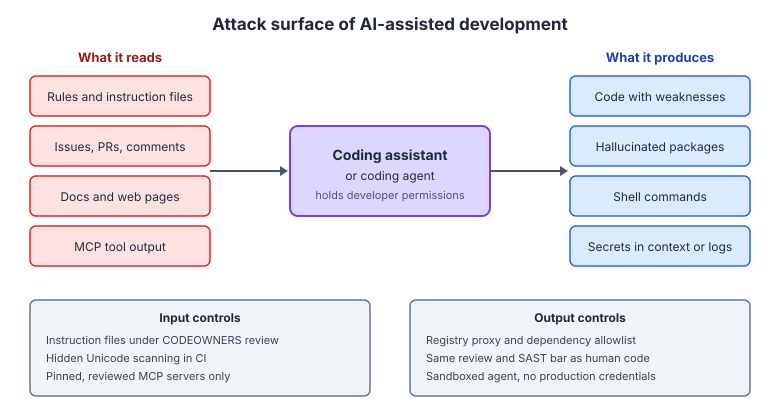

# AI-Assisted Development

Most of this site is about securing AI systems you build. This page is about the AI that builds them. Coding assistants and coding agents now write, refactor, and review a large share of production code, run shell commands on developer machines, and act on issues and pull requests in CI. They bring new ways for attackers to get into your software supply chain, and those need controls just like your build pipeline does.

!!! abstract "Scope"
    This page applies to every engineering team using AI coding tools, not only teams building AI products. Treat a coding agent as a highly productive contributor that holds the permissions of whoever launched it and will act on any instruction it reads.

{ .arch-diagram }

## Threats

| Threat | What happens | Example |
|--------|--------------|---------|
| **Package hallucination (slopsquatting)** | The model suggests a dependency that does not exist. An attacker registers that name with malicious code, and the next developer who accepts the suggestion installs it | Spracklen et al. found hallucinated package names are often repeated across runs, which makes them predictable enough to pre-register |
| **Instruction file backdoors** | Rules and instruction files that steer the assistant carry hidden directives, sometimes in invisible Unicode a human reviewer cannot see | Pillar Security's "Rules File Backdoor" research showed hidden instructions in rules files causing assistants to insert malicious code |
| **Injection through repository content** | Issues, PR descriptions, code comments, or README files contain instructions that a coding agent follows | An agent asked to "fix the open issue" reads an issue written by an attacker |
| **Compromised assistant tooling** | The assistant itself, an extension, or an MCP server it uses is tampered with | In July 2025 a malicious prompt telling the agent to wipe local and cloud resources was merged into a release of the Amazon Q Developer VS Code extension |
| **Abuse of installed AI CLIs** | Malware on a developer machine drives an installed coding agent to search the filesystem for secrets | The August 2025 Nx "s1ngularity" npm compromise used local AI CLIs, invoked with permission checks disabled, to locate credentials and wallets |
| **Insecure generated code** | Generated code compiles and passes tests but contains injection flaws, weak crypto, or missing authorisation checks | Common, because models reproduce patterns from public code, including bad ones |
| **Secret and data leakage** | Source code, secrets in `.env` files, or customer data in fixtures are sent to the assistant provider or written to agent logs | An agent reads a credentials file while exploring the repository |

Several of these combine all three legs of the [lethal trifecta](../../core/injection-resistant-design.md#the-lethal-trifecta). A coding agent typically reads untrusted content, has access to source and secrets, and can push code or make network requests. Design its environment on that assumption.

## Controls

### Dependencies

- Route all package installs through an internal **registry proxy or mirror**. Block direct installs from public registries on developer machines and CI.
- Keep a **dependency allowlist** for production code, or at minimum require review for any new dependency. A new package introduced in an AI-assisted change should get the same scrutiny as one added by hand.
- Flag packages that are **very new, have few downloads, or have no source repository**. Hallucinated names that have been squatted usually look like this. Attackers have also started registering hallucinated names at scale rather than one at a time. See the threat intelligence on [airuntimesecurity.io](https://airuntimesecurity.io/maso/threat-intelligence/emerging-threats/).
- Commit **lockfiles** and verify them in CI. See [CI/CD for AI](ci-cd-for-ai.md).

### Instruction and rules files

Files such as `AGENTS.md`, `CLAUDE.md`, `.cursor/rules/`, `.github/copilot-instructions.md`, and agent skill or prompt files directly control what the assistant does. Treat them as code.

- Put them under **CODEOWNERS** so changes need review from a named owner.
- **Scan for invisible and bidirectional Unicode** in CI and fail the build if any is found:

```bash
LC_ALL=C.UTF-8 grep -rnP '[\x{200B}-\x{200F}\x{202A}-\x{202E}\x{2060}-\x{2064}\x{FEFF}\x{E0000}-\x{E007F}]' \
  AGENTS.md CLAUDE.md .cursor .github/copilot-instructions.md 2>/dev/null && exit 1 || exit 0
```

- Do not accept instruction files from forks, templates, or third-party repositories without reading them in full.
- Version and review agent skills and MCP configuration the same way. See [Prompt and Configuration Management](prompt-and-config-management.md).

### Coding agent permissions

| Control | Requirement |
|---------|-------------|
| **Sandboxed execution** | Agents that run commands do so in a container, VM, or cloud sandbox, not directly on a workstation with access to the home directory |
| **No production credentials** | Agent environments hold no production secrets, cloud admin roles, or long-lived tokens. Use short-lived, scoped credentials. See [Secrets Management](secrets-management.md) |
| **Egress allowlist** | Network access limited to package registries, the source host, and documentation sites you trust. This closes the exfiltration leg |
| **No blanket auto-approve** | Flags or modes that skip permission prompts are restricted to sandboxed environments. They are not allowed on machines holding real credentials |
| **Branch protection** | Agents push to branches, never to protected branches. Merges need human review |
| **Auditable activity** | Agent sessions, commands run, and files changed are logged and linked to the human who started them |

### Agents in CI and on pull requests

Agents that respond to issues, review PRs, or run in CI pipelines read content written by anyone who can open an issue. That is untrusted input by definition.

- Give CI agent tokens the **narrowest scope** that works, such as read-only contents and write access to comments, not repository admin.
- Do not let agents triggered by external contributors run with secrets. Separate workflows for trusted and untrusted triggers.
- Require a maintainer to approve before an agent acts on an issue or PR from outside the organisation.
- Apply the [Rule of Two](../../core/injection-resistant-design.md#the-agents-rule-of-two): an agent that reads public issues should not also hold write access to protected branches and outbound network access.

### MCP servers and extensions

- Maintain an **approved list** of IDE extensions and MCP servers. Pin versions.
- Review MCP tool descriptions, as they are read by the model and can carry instructions. See [Integration Security](integration-security.md) and SUP-05 in [Supply Chain](../../infrastructure/agentic/supply-chain.md).
- Run local MCP servers with the least filesystem and network access they need.

### Review standards for AI-generated code

- AI-generated code meets **the same review bar** as human code. Authorship does not lower it.
- Run SAST, secret scanning, and dependency scanning on every change, whoever or whatever wrote it.
- Reviewers check the things models get wrong most: authorisation checks, input validation, error handling that leaks detail, and cryptography.
- Large AI-generated changes are split into reviewable units. A 3,000-line diff that no human has read is not reviewed.
- Use an AI reviewer as an extra check if you like, not as the only one. It can be fooled by the same injected content as the author.

### Data handling

- Use assistant plans whose terms exclude your code and prompts from model training, and confirm retention periods.
- Exclude secrets, credentials, and regulated data from assistant context using the tool's ignore configuration.
- Keep real customer data out of test fixtures that agents will read.

## Fitting this into the SDLC

| SDLC phase | Addition for AI-assisted development |
|------------|--------------------------------------|
| **Design** | Decide which coding tools are approved and what permissions their agents hold |
| **Build** | Registry proxy, instruction file review, sandboxed agents |
| **Test** | SAST and dependency checks on all changes, Unicode scanning on instruction files |
| **Deploy** | Branch protection and human merge approval for agent-authored changes |
| **Run** | Monitor agent activity logs, rotate any credential an agent could have read after a suspected compromise |

See the [AI-Aware SDLC](../../getting-started/ai-sdlc.md) for the full lifecycle.

!!! info "References"
    - [Spracklen et al.: We Have a Package for You! A Comprehensive Analysis of Package Hallucinations by Code Generating LLMs (arXiv:2406.10279)](https://arxiv.org/abs/2406.10279)
    - [Pillar Security: New Vulnerability in GitHub Copilot and Cursor, the Rules File Backdoor](https://www.pillar.security/blog/new-vulnerability-in-github-copilot-and-cursor-how-hackers-can-weaponize-code-agents)
    - [AWS Security Bulletin AWS-2025-015: Amazon Q Developer for VS Code](https://aws.amazon.com/security/security-bulletins/AWS-2025-015/)
    - [Nx: s1ngularity security incident postmortem](https://nx.dev/blog/s1ngularity-postmortem)
    - [OWASP Top 10 for LLM Applications: LLM03 Supply Chain](https://genai.owasp.org/llmrisk/llm032025-supply-chain/)
    - [OWASP Agentic Skills Top 10](https://owasp.org/www-project-agentic-skills-top-10/)
    - [AI Runtime Security: Emerging threats (slopsquatting and skills)](https://airuntimesecurity.io/maso/threat-intelligence/emerging-threats/)
    - [Trojan Source: Invisible Vulnerabilities (bidirectional Unicode)](https://trojansource.codes/)
    - [AI Runtime Security: The MCP Problem](https://airuntimesecurity.io/insights/the-mcp-problem/)
