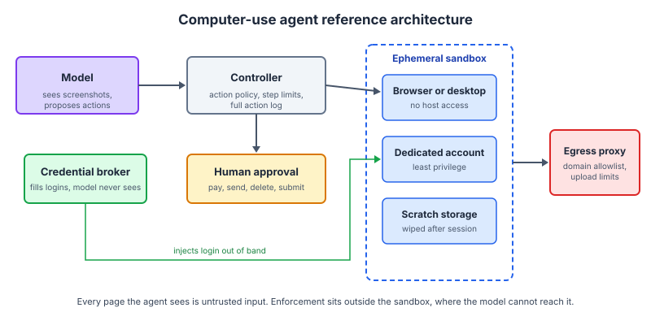

# Computer-Use and Browser Agents

**Computer-use agents** control a desktop or browser the way a person does: they take screenshots, read the page, move the pointer, click, and type. **Browser agents**, including AI features built into web browsers, do the same within a browser. They can automate tasks for which no API exists, which is why teams want them. They are also the hardest kind of agent to secure, because almost everything they see is untrusted and almost everything they can do happens through an interface built for humans.

## Why they need their own controls

| Property | Tool-calling agent | Computer-use agent |
|----------|--------------------|--------------------|
| **Inputs** | Structured tool output | Every pixel and every word on every page visited, including ads, comments, and hidden text |
| **Action granularity** | Named operations with typed parameters | Clicks and keystrokes. "Transfer funds" and "view balance" may be one click apart |
| **Authorisation** | API scopes per operation | Whatever the logged-in account can do in the UI |
| **Credentials** | Injected by a gateway | Often held in the browser session the agent controls |
| **Enforcement point** | Tool gateway | Harder to place. Must sit around the environment, not inside it |

Researchers have repeatedly shown browser agents following instructions hidden in web pages, including Brave's 2025 disclosure of indirect prompt injection in Perplexity's Comet browser, where a hidden instruction on a page could direct the agent to read data from the user's other logged-in sessions. In August 2026 Zenity Labs showed the same class of zero-click attack (*PleaseFix*) working against five agentic browsers from five model providers. The root cause is structural: a browser agent reasons across content from many origins in one session, which breaks the **same-origin principle** the web relies on for isolation. The runtime analysis is in [ET-14 on airuntimesecurity.io](https://airuntimesecurity.io/maso/threat-intelligence/emerging-threats/#et-14-computer-use-and-browser-agents-expand-the-action-surface). Agent vendors themselves recommend running these tools in an isolated environment with limited privileges and keeping a human in the loop for consequential actions.

!!! warning "Treat the screen as untrusted input"
    A computer-use agent holds all three legs of the [lethal trifecta](injection-resistant-design.md#the-lethal-trifecta) by default: it reads untrusted pages, it can reach whatever the logged-in account can reach, and it can submit forms and navigate anywhere. Design must remove at least one leg.

## First decision: do you need it?

Use a computer-use agent only when there is no better interface.

| If... | Use |
|-------|-----|
| The target system has an API | A tool-calling agent behind a [tool gateway](../infrastructure/agentic/tool-access-controls.md) |
| The task is fixed and repetitive | Conventional automation (RPA or scripted browser tests), optionally with a model choosing between fixed scripts |
| The UI is internal and you control it | Add an API, or expose the needed operations as tools |
| The task needs judgement across third-party sites with no API | A computer-use agent, with the controls below |

## Reference architecture

The environment, credential, and egress requirements below are infrastructure control [SAND-07](../infrastructure/agentic/sandbox-patterns.md#sand-07-isolate-coding-and-computer-use-agents).

{ .arch-diagram }

### Environment

- Run the agent in a **dedicated, ephemeral VM or container**, destroyed after each task. Never on a user's own workstation or in their everyday browser profile.
- No shared clipboard, filesystem mounts, or host network access.
- Scratch storage is wiped at session end. Downloads are scanned before anything leaves the sandbox.

See [Sandbox Patterns](../infrastructure/agentic/sandbox-patterns.md).

### Identity and credentials

- The agent uses a **dedicated account** with the least privilege the task needs, not the user's personal account. Where a site only offers personal accounts, scope the task so that sensitive pages are out of reach.
- No saved passwords in the sandboxed browser. A **credential broker** fills login fields directly, so credentials never appear in the model's context or screenshots. Alternatively, hand control to the human for login.
- Session cookies are short-lived and discarded with the sandbox.

See [Identity and Access](../infrastructure/controls/identity-and-access.md) and [IAM Governance](iam-governance.md).

### Network

- All traffic leaves through an **egress proxy with a domain allowlist** for the task. A procurement agent that needs three supplier sites gets those three.
- Block file upload to destinations outside the allowlist.
- Scope each task to the origins it needs, and require human confirmation for any action on an origin other than the one the user asked about. This replaces the same-origin isolation a browser agent otherwise loses.
- Separate sessions that browse the open web from sessions that are logged in to sensitive systems. This applies the [Rule of Two](injection-resistant-design.md#the-agents-rule-of-two): the open-web session has untrusted input but no sensitive access, and the logged-in session has sensitive access but a narrow allowlist.

See [Network and Segmentation](../infrastructure/controls/network-and-segmentation.md).

### Actions

- A **controller outside the sandbox** receives every proposed action, applies policy, and executes it. The model cannot act on the environment directly.
- Define **consequential actions** in advance and require human approval for them: payments, sending messages, submitting forms, deleting, changing account settings, accepting terms, and entering any credential.
- Set **step and time limits** per task. Agents that loop on a page are a common failure and a cost risk.
- Where possible, the controller checks the URL and page element before a click is executed, not only the model's description of it.

### Logging and privacy

- Record every action, URL, and approval decision. Keep screenshots for HIGH and CRITICAL tiers, as they are often the only way to reconstruct what the agent saw.
- Screenshots capture whatever is on screen, including personal data. Apply [Data Protection](../infrastructure/controls/data-protection.md) controls and set a retention period.

## Controls by risk tier

| Tier | Minimum expectation |
|------|---------------------|
| **LOW** | Read-only tasks on public sites, ephemeral sandbox, no credentials |
| **MEDIUM** | Dedicated account, domain allowlist, approval for any submit or send |
| **HIGH** | Credential broker, controller-enforced action policy, full action and screenshot log, open-web and logged-in sessions separated |
| **CRITICAL** | Avoid computer-use agents. If unavoidable, human approval on every state-changing action and independent design review |

## Testing before deployment

- Build test pages that contain hidden instructions in text, alt attributes, white-on-white text, and images, and confirm the agent does not act on them or that the controller blocks it.
- Test that the egress allowlist holds when the agent is told to visit another site.
- Test that approval prompts cannot be bypassed by the agent using keyboard shortcuts or alternative UI paths.

See [Adversarial Testing](../getting-started/adversarial-testing.md).

## Handoff to runtime

Runtime monitoring should watch for navigation outside the expected flow, repeated failed approvals, and unusual volumes of data on screen. See [AI Runtime Security](https://airuntimesecurity.io/core/) for monitoring and response.

!!! info "References"
    - [Anthropic: Computer use tool documentation](https://docs.anthropic.com/en/docs/agents-and-tools/tool-use/computer-use-tool)
    - [Brave: Agentic browser security, indirect prompt injection in Perplexity Comet](https://brave.com/blog/comet-prompt-injection/)
    - [OpenAI: Computer-Using Agent](https://openai.com/index/computer-using-agent/)
    - [Meta AI: Agents Rule of Two](https://ai.meta.com/blog/practical-ai-agent-security/)
    - [AI Runtime Security: ET-14, Computer-use and browser agents expand the action surface](https://airuntimesecurity.io/maso/threat-intelligence/emerging-threats/)
    - [OWASP LLM06:2025 Excessive Agency](https://genai.owasp.org/llmrisk/llm062025-excessive-agency/)
