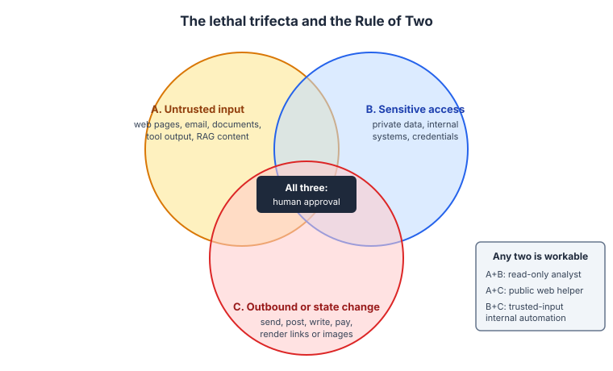
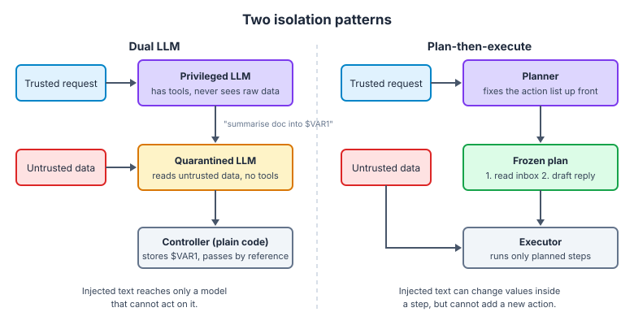

# Injection-Resistant Design

Prompt injection has no reliable fix at the model level. Guardrails and judges catch a lot of it, but they are probabilistic, and an attacker only needs one attempt to get through. The decision that does the most to limit the damage is made before any guardrail is configured: **what the system is allowed to do once it has read untrusted text**.

This page covers the design patterns that answer that question. They do not stop a model from being fooled. They make sure that when it is fooled, there is little it can do about it.

!!! abstract "The design principle"
    Assume any model that reads untrusted content will follow instructions hidden in it. Design the system so that following them cannot reach sensitive data and an outbound channel in the same session.

## Why this belongs at design time

Runtime controls inspect content. Design-time patterns constrain capability. The two fail differently:

| Approach | What it relies on | How it fails |
|----------|-------------------|--------------|
| **Input and output guardrails** | Recognising malicious text | Novel phrasing, encoding, multimodal payloads, or content split across turns |
| **Model-as-judge** | A second model spotting the problem | The judge reads the same injected content and [can be fooled too](https://airuntimesecurity.io/core/when-the-judge-can-be-fooled/) |
| **Architectural isolation** | Data flow and permissions that hold regardless of what the model believes | Mistakes in the design itself, such as an exfiltration channel nobody mapped |

Architectural controls are also the cheapest to apply early and the most expensive to retrofit. Splitting an agent into a privileged planner and a quarantined reader after launch usually means a rewrite.

## The lethal trifecta

Simon Willison's **lethal trifecta** names the combination that turns prompt injection from a nuisance into a data breach. An AI system is exposed when it has all three of:

1. **Access to private data**, such as a mailbox, a document store, or a customer record.
2. **Exposure to untrusted content**, meaning any text or image an attacker can influence, including web pages, inbound email, uploaded files, issue comments, and tool output.
3. **A way to communicate externally**, such as sending email, calling an API, posting a comment, or rendering a Markdown image whose URL carries data.

With all three present, an instruction planted in the untrusted content can tell the model to read private data and send it out. Removing any one leg closes that path.

The third leg is the one teams miss most often. Rendering a Markdown image is an outbound request. So is a link preview, a webhook, a git push, or a search query to a public engine. When you map outbound channels, include every way the system can cause a request to leave your boundary.

{ .arch-diagram }

## The Agents Rule of Two

Meta's **Agents Rule of Two** turns the trifecta into a design rule. Within a single session, an agent should satisfy no more than two of:

- **[A]** It processes untrustworthy inputs.
- **[B]** It has access to sensitive systems or private data.
- **[C]** It can change state or communicate externally.

If a use case genuinely needs all three, the agent should not run autonomously. It needs human approval or another reliable validation step before acting.

Leg C here is broader than the trifecta. It covers changing state as well as exfiltration, so an agent that can delete records counts even if it cannot send anything out.

### Applying it per session, not per system

The rule applies to a session, not to the system as a whole. A system can hold all three capabilities as long as no single session holds them at once. Common ways to achieve that:

| Technique | Example |
|-----------|---------|
| **Drop a capability once untrusted data enters** | After the agent opens an external web page, its outbound tools are disabled for the rest of the session |
| **Split into separate sessions** | One session reads inbound email and writes a structured summary. A second session, which never sees the raw email, acts on the summary |
| **Make the outbound channel non-attacker-controlled** | The agent can only send to addresses on a fixed allowlist, or only post to an internal ticket queue |
| **Downgrade data access** | The session that reads untrusted documents gets a read-only, low-sensitivity view rather than the full store |

Enforce these in infrastructure, not in the system prompt. A prompt that says "do not send email after reading a web page" is exactly the kind of instruction an injection overrides. Tool availability belongs in the [tool gateway](../infrastructure/agentic/tool-access-controls.md), and network reach belongs in [network segmentation](../infrastructure/controls/network-and-segmentation.md). See [infrastructure beats instructions](https://airuntimesecurity.io/insights/infrastructure-beats-instructions/).

## Design patterns

Beurer-Kellner and colleagues (2025) set out six patterns that give agents provable resistance to prompt injection, each trading some flexibility for isolation. They share one idea: once an LLM has read untrusted input, it must not be able to trigger consequential actions.

| Pattern | How it works | What injection can still do | Fits |
|---------|--------------|-----------------------------|------|
| **Action-selector** | The model maps a request to one of a fixed set of actions. Tool output is never fed back to the model | Very little. The model never reads attacker content after choosing | Customer-service routing, command dispatch |
| **Plan-then-execute** | The model writes a fixed plan from the trusted request before reading any untrusted data. Execution follows the plan | Change the values inside planned steps, such as the content of a drafted reply, but not add new actions | Workflow agents with predictable steps |
| **LLM map-reduce** | Each untrusted item is handled by an isolated sub-agent that returns a constrained result, such as a boolean or a value from a schema. Results are combined by code or a model that never sees the raw items | Affect the result for its own item only | Screening many documents, CVs, or tickets |
| **Dual LLM** | A privileged model holds the tools but never reads untrusted content. A quarantined model reads it but has no tools. Results pass between them as symbolic references | Corrupt the quarantined model's output value, which the privileged model handles without reading | Assistants that act on email, documents, or web content |
| **Code-then-execute** | The model writes a program in a restricted language, which then runs. Untrusted data flows through variables, not through the model's context | Corrupt data values, which policies on data flow can then block | Complex agents that still need strong guarantees |
| **Context-minimisation** | Content the model no longer needs, including the user's original prompt, is removed from context before later steps | Less, because earlier injected text is no longer present to influence later steps | Multi-step flows with a mix of trusted and untrusted stages |

{ .arch-diagram }

### CaMeL

**CaMeL** (Google DeepMind, 2025) is the most complete version of code-then-execute. A privileged model turns the trusted user request into a program. A quarantined model, with no tool access, parses untrusted data into typed values. A custom interpreter runs the program and attaches **capabilities** to every value, recording where it came from and who may receive it. Before each tool call, the interpreter checks a security policy against those capabilities. An email address extracted from an untrusted document, for example, cannot be used as the recipient of a message containing private data.

The cost is utility. CaMeL completes fewer tasks than an unprotected agent on the AgentDojo benchmark, and writing the security policies takes real effort. For high-risk agents that need flexibility and strong guarantees, it is the reference design to study.

## Choosing a pattern by risk tier

| Tier | Minimum expectation |
|------|---------------------|
| **LOW** | Map the three trifecta legs. Remove outbound rendering channels you do not need, such as external images in chat output |
| **MEDIUM** | Rule of Two enforced per session in infrastructure. Untrusted content labelled as such wherever it enters context |
| **HIGH** | One of the isolation patterns above for any flow where untrusted content meets sensitive data. Human approval where a session must hold all three |
| **CRITICAL** | Isolation pattern plus data-flow policy (CaMeL-style or equivalent) with documented proof that no untrusted value can reach a sensitive sink unreviewed. Independent review of the design |

See [Risk Tiers](risk-tiers.md) for how tiers are assigned.

## Design review checklist

Run this during [threat modelling](../threat-modelling.md), before implementation starts:

- [ ] Every input source is classified as trusted or untrusted. Tool output, retrieved documents, and memory are untrusted unless proven otherwise.
- [ ] Every outbound channel is listed, including rendered images, links, previews, webhooks, and search queries.
- [ ] For each session type, you can state which of A, B, and C it holds.
- [ ] Any session holding all three has a named human approval step or a pattern from this page that removes one leg.
- [ ] The restriction is enforced by the tool gateway, credentials, or network, not by instructions in the prompt.
- [ ] Memory and long-lived context are treated as untrusted input on later reads. See [Memory and Context](memory-and-context.md).
- [ ] In multi-agent systems, messages from other agents are treated as untrusted. See [Multi-Agent Controls](multi-agent-controls.md).

## What design does not solve

These patterns limit what an injection can *do*. They do not stop an injection from:

- Producing a misleading summary or a wrong answer within the actions the system is allowed to take.
- Exploiting a user who is themselves the attacker, which is a permissions problem rather than an isolation one.
- Abusing a channel the design missed.

Runtime controls still matter for those cases. Hand the design over with a clear statement of which legs each session holds, so the runtime team knows where to focus [guardrails, judges, and human oversight](https://airuntimesecurity.io/core/). Related pages: [Agentic AI Controls](agentic.md) and [Sandbox Patterns](../infrastructure/agentic/sandbox-patterns.md).

!!! info "References"
    - [Simon Willison: The lethal trifecta for AI agents](https://simonwillison.net/2025/Jun/16/the-lethal-trifecta/)
    - [Simon Willison: The Dual LLM pattern for building AI assistants that can resist prompt injection](https://simonwillison.net/2023/Apr/25/dual-llm-pattern/)
    - [Meta AI: Agents Rule of Two, a practical approach to AI agent security](https://ai.meta.com/blog/practical-ai-agent-security/)
    - [Beurer-Kellner et al.: Design Patterns for Securing LLM Agents against Prompt Injections (arXiv:2506.08837)](https://arxiv.org/abs/2506.08837)
    - [Debenedetti et al.: Defeating Prompt Injections by Design (CaMeL, arXiv:2503.18813)](https://arxiv.org/abs/2503.18813)
    - [AgentDojo benchmark](https://agentdojo.spylab.ai/)
    - [OWASP LLM01: Prompt Injection](https://genai.owasp.org/llmrisk/llm01-prompt-injection/)
