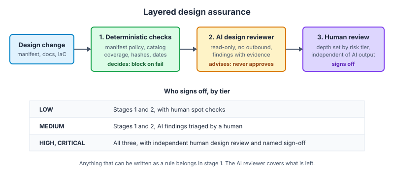

# Automating Design Assurance

Most of the design guidance on this site is checked by people reading documents. That does not scale, and it does not catch drift between what was reviewed and what was built. This page sets out how to automate the parts that can be automated, where AI can help review a design, and where a person still has to decide.

!!! abstract "The principle"
    Anything that can be written as a rule is checked deterministically and blocks the build. An AI reviewer covers what is left and advises. A named person signs off, with the depth of review set by the risk tier.

{ .arch-diagram }

## Start with a design manifest

Infrastructure is already checked by policy as code: the [OPA and Kyverno policies](../infrastructure/policy/README.md) catch a pod without egress controls or a token with the wrong scope. The design itself usually exists only in prose and diagrams, so nothing can check it.

A **design manifest** is a short YAML file kept next to the system's code that states the facts a design review depends on:

| Section | What it declares | Control |
|---------|------------------|---------|
| `system` | Name and [risk tier](risk-classification.md) | All |
| `sessions` | Each session type and which [Rule of Two](../core/injection-resistant-design.md#the-agents-rule-of-two) properties it holds, plus any approval step and isolation pattern | SESS-06 |
| `models` | Every model, including guardrail and judge models, with pinned version and retirement date | SUP-10 |
| `tools` | Approved tools and the hash of each definition | TOOL-07 |
| `telemetry_profile` | Path to the versioned [expected telemetry profile](expected-telemetry.md) the runtime monitor compares against | OB-2.9 (runtime) |

A [complete example](../infrastructure/policy/examples/design-manifest.example.yaml) and a [tested OPA policy](../infrastructure/policy/opa/design_manifest.rego) that checks it are included with the policy templates.

The manifest is only useful if it matches what is deployed. Generate what you can rather than typing it:

- Tool hashes from the approved tool manifest the [tool gateway](../infrastructure/agentic/tool-access-controls.md) enforces.
- The model list and versions from the [AI-BOM](../infrastructure/agentic/supply-chain.md#sup-07-maintain-ai-component-inventory-ai-bom).
- Session capabilities from the gateway's per-session tool grants, so the declared properties and the enforced ones come from the same source.

## Deterministic checks

These run on every pull request and fail the build when they fail.

| Check | How | Control |
|-------|-----|---------|
| **Rule of Two** | `design_manifest.rego`: any session holding all three properties without an approval step fails | SESS-06 |
| **Isolation for high tiers** | Same policy: at HIGH and CRITICAL, untrusted input plus sensitive access needs a named isolation pattern | SESS-06 |
| **Model pinning and retirement** | Same policy: unpinned or retired models fail; retirement within 90 days warns | SUP-10 |
| **Tool definition pinning** | Same policy for the manifest; the gateway re-checks the hash at load | TOOL-07 |
| **Controls required by tier** | Compare the [control catalog](../infrastructure/catalog/README.md) against the controls the system implements | All |
| **Prompt and config changes** | Run the evaluation gate when prompts, tool definitions, or guardrail settings change | SUP-09 |
| **Instruction file backdoors** | Scan rules and instruction files for hidden Unicode | SAND-07 |
| **Infrastructure policy** | Existing OPA and Kyverno policies against IaC and manifests | NET, TOOL, SEC |

A scheduled job adds one check that a pull request cannot: it re-evaluates the manifest each week, because a model's retirement date gets closer even when nobody changes the code.

```yaml
# .github/workflows/design-assurance.yml (excerpt)
- uses: open-policy-agent/setup-opa@v2
  with:
    version: latest
- name: Check design manifest
  run: |
    opa eval --fail-defined \
      -d policy/design_manifest.rego \
      -i design-manifest.yaml \
      'data.design.manifest.deny[_]'
```

`--fail-defined` makes `opa eval` exit non-zero when any `deny` message exists, which is what turns the policy into a gate.

At runtime, the system reports the configuration and tool hashes it actually loaded. A mismatch with the approved values is an incident, not a warning. See the [Control Handoff Matrix](../infrastructure/handoff-matrix.md).

## Using AI to review designs

### Where it helps

An AI reviewer reads design documents, diagrams, IaC, and the manifest faster than a person, and is good at some specific things:

- Spotting **outbound channels nobody listed**, such as rendered Markdown images, link previews, webhooks, and search queries. These are the usual missing leg in a [lethal trifecta](../core/injection-resistant-design.md#the-lethal-trifecta) analysis.
- Finding **trust boundaries missing from a diagram**, and **mismatches** between the written design, the manifest, and the IaC.
- Drafting a first-pass [threat model](../threat-modelling.md) and mapping components to threat categories.
- Generating adversarial test material, such as pages with hidden instructions for testing [computer-use agents](../core/computer-use-agents.md).

### Why it cannot approve

- **It is a probabilistic check on a security decision.** It will miss things, and it will not always miss the same things.
- **The reviewer reads untrusted content.** Design documents, issues, and repository files can carry instructions telling it to report no findings. It is itself an agent that needs the controls on this site.
- **Reviewers anchor on its output.** A clean AI report makes a human less likely to look closely.
- **Accountability needs a person.** Regulators and auditors expect a named owner to sign off a design, and the EU AI Act's risk management and human oversight duties assume one. See [Regulatory Alignment](regulatory-alignment.md).

### Controls on the reviewer

| Control | Requirement |
|---------|-------------|
| **Rule of Two** | The reviewer is read-only and has no outbound network access. It reads untrusted content, so it must not hold the other two legs |
| **Structured output** | Findings are returned as data: location, rule or threat, evidence quoted from the source, and confidence. Free text that says "looks fine" is not a finding |
| **Measured accuracy** | Keep a set of test designs with known flaws. Track how many it finds and how many false alarms it raises, and re-measure when its model or prompt changes, the same way as for a [model-as-judge](../core/judge-assurance.md) |
| **Versioned like any prompt** | The reviewer's prompt and model go through the [prompt and configuration](../building/devops/prompt-and-config-management.md) release gate |
| **Independent human review** | At HIGH and CRITICAL, the human reviewer forms a view before reading the AI findings |

## Who signs off, by tier

| Tier | Deterministic checks | AI reviewer | Human |
|------|----------------------|-------------|-------|
| **LOW** | Required, blocking | Runs on every change | Spot checks. Fits the [low-risk fast lane](ai-sdlc.md#low-risk-fast-lane) |
| **MEDIUM** | Required, blocking | Runs on every change | Triages AI findings and signs off |
| **HIGH** | Required, blocking | Input to review | Independent design review and named sign-off |
| **CRITICAL** | Required, blocking | Input to review | Independent design review, named sign-off, and review by someone outside the delivery team |

## Getting started

1. Write a design manifest for one existing system, starting with `sessions`. The act of declaring A, B, and C per session usually finds the first problem.
2. Add `design_manifest.rego` to CI as a warning for two weeks, then make it blocking.
3. Generate the `tools` and `models` sections from the gateway manifest and the AI-BOM.
4. Add the AI reviewer last, once you have test designs to measure it against.

!!! info "References"
    - [Open Policy Agent: policy testing](https://www.openpolicyagent.org/docs/latest/policy-testing/)
    - [open-policy-agent/setup-opa GitHub Action](https://github.com/open-policy-agent/setup-opa)
    - [Meta AI: Agents Rule of Two](https://ai.meta.com/blog/practical-ai-agent-security/)
    - [NIST AI Risk Management Framework](https://www.nist.gov/itl/ai-risk-management-framework)
    - [AI Runtime Security: Judge assurance](https://airuntimesecurity.io/core/judge-assurance/)
