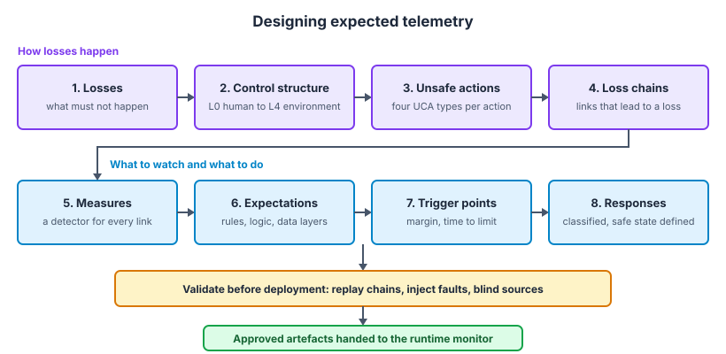

# Designing Expected Telemetry

A runtime monitor can only tell you something is wrong if someone has said, in advance, what right looks like. On [airuntimesecurity.io](https://airuntimesecurity.io/maso/controls/comoverlay/), the **Comoverlay** monitor compares what an AI system should be doing with what it is doing, and reports the posture, what is wrong, and what it cannot tell. Every part of that comparison depends on artefacts designed before deployment:

- what the system is expected to do at each stage;
- which deviations matter;
- where the alert thresholds sit;
- how failures chain together into a loss.

This page is how to design them. Without them, the monitor can only answer "can't say", and the runtime site treats that as lost protection.

!!! abstract "The principle"
    Start from the losses you must prevent, work out how the system could reach them, and only then decide what to measure. Telemetry chosen because it is easy to collect watches the wrong things.

{ .arch-diagram }

## When you need it

| Tier | Expected telemetry |
|------|--------------------|
| **LOW** | Not required. Basic logging and the [production readiness](production-readiness.md) minimum are enough |
| **MEDIUM** | Recommended for agentic systems: losses, control structure, and a profile for the act stage |
| **HIGH** | Required for agentic systems. All eight steps, validated before deployment |
| **CRITICAL** | Required. All eight steps, invariants against systems of record, and an independent review of the chain library |

Any workflow that moves money or can cause physical harm needs the full set, whatever its tier. On the runtime site these are the *payment* and *safety-critical* workflows that get the strictest response rule.

## Where it fits in the lifecycle

| [SDLC](ai-sdlc.md) phase | Expected telemetry work |
|-------|-------------------------|
| **Design** | Steps 1 to 4: losses, control structure, unsafe control actions, loss chains. Run alongside [threat modelling](../threat-modelling.md) |
| **Build** | Steps 5 and 6: instrument the sources, give the monitor read access to systems of record, write the profile |
| **Test** | Steps 7 and 8, then validation: replay chains, inject faults, check timing |
| **Deploy** | Artefacts approved at the [deployment gate](production-readiness.md) and handed to the runtime team |
| **Run** | Early operation narrows the data-layer bands. The deviation log feeds the next release |

## Step 1: Define the losses

List what must not happen, in business terms, before thinking about the AI. A loss is an outcome someone would have to report or pay for:

- money paid to the wrong party, or more than was owed;
- personal or confidential data disclosed;
- access granted to someone not entitled to it;
- a wrong decision applied to a customer or patient;
- physical harm or damage to equipment.

Keep the list short, and rank it. Every later step traces back to one of these losses. A measure that cannot be traced to a loss is noise.

## Step 2: Draw the control structure

Model the system as a hierarchy of controllers, each issuing control actions to the level below and receiving feedback from it. Use the same five levels as the runtime site:

| Level | Controller | Examples of control actions |
|-------|------------|-----------------------------|
| **L0** | Human principal or approver | Approve, reject, amend the mandate |
| **L1** | Mandate, orchestrator, platform configuration | Grant permissions, set the environment, delegate |
| **L2** | Agent | Choose tools, read data, produce output |
| **L3** | Gateway, tool, credential | Execute or refuse a call |
| **L4** | Environment and systems of record | Hold the real state where the loss happens |

Draw the feedback paths too. Many accidents come from a controller acting on feedback that was missing, late, or wrong.

## Step 3: Find unsafe control actions

For every control action at every level, ask STPA's four questions:

| Question | Example |
|----------|---------|
| **Not provided:** what if it does not happen? | The approval request is never sent. A required check is skipped |
| **Provided when unsafe:** what if it happens in the wrong context? | A refund to a changed bank account. A tool call outside the task |
| **Wrong timing or order:** what if it is early, late, or out of sequence? | Payment issued before verification completes |
| **Held too long or stopped too soon:** what if it lasts the wrong length of time? | A credential outlives its session. A stop leaves a transaction half done |

Apply the same questions to the responses the system can take, such as pausing an agent, revoking a credential, or rolling back. A response is a control action too, and some responses can themselves cause a loss.

## Step 4: Build loss chains

Losses come from chains of control flaws across levels, rarely from one failure. Link the unsafe control actions from step 3 into scenarios that end in a loss from step 1, and mark the last link before the loss. This is the same shape as an attack path, and it should be done with the [threat model](../threat-modelling.md) rather than separately.

Start from known chains. The runtime site keeps a [chain library](https://airuntimesecurity.io/maso/controls/comoverlay/#chain-library-from-known-incidents) drawn from real incidents, including EchoLeak, the GitHub MCP exfiltration, and the 2026 evaluation breaches. Ask, for each one, whether your system has the same links.

## Step 5: Choose a measure for every link

Every link in every chain needs a detector. There are three kinds:

| Detector | Use for | Example |
|----------|---------|---------|
| **Parameter** | Something with a normal range or an allowed set | Records read per task, refund amount, tools called, egress destinations |
| **Invariant** | A relationship the real world must satisfy | Refund does not exceed the original payment. Access matches entitlements |
| **Event** | Something that must or must not happen within a stage | Approval received before the act stage starts |

### Give each parameter a signal type

Statistical detectors were designed for numeric sensor data, and most agent telemetry is not numeric. Declare a signal type for each parameter so the runtime monitor uses the right detector:

| Signal type | Examples | How it is judged |
|-------------|----------|------------------|
| **Numeric** | Cost, rate, latency, counts, amounts | Distance from the expected band, combined across parameters, with slow-drift detection |
| **Categorical membership** | Tool, destination, data scope | In the contract's allowed set or not. Needs no history, so it carries most of the load at launch |
| **Categorical mix** | Proportions of tools or destinations used | Distribution distance from the baseline |
| **Sequence** | Order of tool calls in a task | Transition probabilities from the baseline. A never-seen transition is flagged |
| **Text** | Outputs, messages, arguments | Deterministic checks first, such as patterns and DLP rules. Similarity scores are supporting evidence only |

Put as much as you can into categorical membership and invariants. They work from day one and are hard to argue with.

A link with no detector is a gap in the design. Either add a detector or record the gap as an accepted risk.

### Choose sources the agent cannot shape

The runtime monitor treats its inputs as untrusted, because an agent, or an attacker steering one, can shape its own traces. Design for that now:

- **Use platform sources, not the agent:** gateway logs, tool proxy, egress proxy and network layer, orchestrator state, credential issuer. An agent that writes its own traces can lie in them, so the runtime monitor does not use the agent's self-report as evidence. It only compares the self-report with the platform's record, and treats a mismatch as a deviation. If a parameter can only be measured from the agent's own account, redesign until the platform can see it.
- **Give the monitor read access to systems of record**, such as the payments ledger, the business system, and the identity provider. Invariants checked there are the strongest evidence the monitor will have.
- **Group sources by failure mode.** Two copies of the same feed are one source, not two. The runtime monitor only lowers trust in a source on evidence from a different group, so independent groups are what keep it from being argued blind.
- **Mark systems of record as such.** They get a trust floor at runtime, so they stay usable as evidence when other sources are under attack.
- **Make context trusted.** The task stage that selects the expectation must come from the orchestrator or a system of record, not from the agent.

## Step 6: Set the expectations

Write the **expected telemetry profile**: per task stage, each parameter's target, tolerance band, hard limit, and sources. Use the default stages (plan, retrieve, act, report) unless the workflow needs more. Expectations come from three layers:

| Layer | Where it comes from | Available at launch? |
|-------|---------------------|----------------------|
| **Rules** | Policy, contracts, regulation, the agent's mandate and tool manifest | Yes |
| **Logic** | Invariants and what the value should be given current state | Yes |
| **Data** | Historical spread per stage and condition | No. Start with wide bands from test runs and shadow mode, and narrow them in operation |

Plan for two kinds of "can't say" at launch. **No baseline** is expected and fixes itself with operation; rules and contract checks still work meanwhile. **Low trust** means the sources themselves are in doubt and needs investigating. The runtime monitor reports them separately.

Baselines are frozen per release. Narrowing a band after launch is a change like any other: it needs approval and a diff against the previous baseline. Otherwise an attacker could shift "normal" a little at a time through the deviation log, which is normalisation of deviance done deliberately.

Decide also **which context changes are legitimate**: the events that should switch the expected profile, such as a refund approved by a supervisor. Name their trusted source, which must be a system of record or a human amendment, never the agent or its inputs. Set a maximum rate of switches per workflow. At runtime, actions after a switch are checked against both the old and new profiles for a short window, and an action that only fits because of a just-arrived event is flagged.

Also record the **safest expected action** for each stage: what a person should do if an alert fires there, such as "hold the refund for review". The runtime monitor puts it in every alert.

The runtime site has a [worked profile for a refund agent](https://airuntimesecurity.io/maso/controls/comoverlay/#example-customer-refund-agent) that you can adapt.

## Step 7: Set the trigger points

For each parameter, decide when the monitor should report, alert, and escalate. Base this on two things:

- **Margin:** how far the value is from its hard limit.
- **Time to limit:** how long, at the current rate, until it gets there.

Two design rules matter more than the exact numbers:

- **Timing must fit.** Both escalation windows, plus the time to move to the safe state, must together fit inside the time to limit. If they cannot, either make an immediate automatic pause safe for this workflow, or lower the alert threshold so escalation starts sooner.
- **Measure human response time.** An escalation window shorter than the time people actually take to answer is a design fiction.
- **Set a false-alarm target.** Escalation that fires too often teaches people to ignore it. Declare the false-alarm rate each workflow can tolerate, per tier. The runtime team tracks it as a key metric, and thresholds are tuned against it through approved changes.
- **Mark the critical parameters.** "Can't say" on a parameter that guards a hard limit is treated as lost protection and triggers the workflow's safest classified response, like flying a known safe attitude on unreliable airspeed. Step 8 decides what that response is.

The runtime site lists [default trigger points](https://airuntimesecurity.io/maso/controls/comoverlay/#5-alert-trigger-points) as a starting point.

## Step 8: Classify responses and define the safe state

For each response the system can take automatically, use the four questions from step 3 to decide whether the response itself can cause a loss in this workflow. The runtime rule is strict:

- logging and alerting are always automatic;
- pausing an agent, or blocking one action, is automatic only where classified safe;
- revoking credentials, stopping an agent, and rolling back always need a person, as does any response in a payment or safety-critical workflow.

Then design the workflow's **safe state**: what happens when an alert goes unanswered all the way up the escalation chain. For example, hold queued actions, refuse new tasks, and finish only the in-flight atomic step. It is never a kill, and it must be tested.

The workflow's accountable owner sets the significant-loss threshold that decides which responses count as dangerous, and signs off the classification.

## Validate before deployment

Test the design in a staging environment before it goes to the deployment gate. Each test has a pass condition:

| Test | Pass condition |
|------|----------------|
| Replay each chain from step 4 | Every link is detected, and escalation follows the chain rule: one link logs, two links at different levels report, three links or a final-stage link alert |
| Push a parameter towards its hard limit at the fastest realistic rate | The alert fires, and escalation plus the safe state complete before the limit |
| Make two source groups disagree | The monitor reports bad data rather than passing silently |
| Remove the trusted sources for a parameter | The monitor reports "can't say", and the runtime team sees it as lost protection |
| Fake a context change from the agent's output | The expectation does not switch |
| Have one trusted independent source confirm a deviation while others disagree | The deviation stands and is reported alongside the disagreement |
| Inject a legitimate-looking event just before an out-of-profile action | The action is flagged in the dual-expectation window |
| Drive down trust in several sources quickly | The runtime monitor raises a trust-collapse alert |
| Make the agent's self-report disagree with the platform's record | Treated as a deviation. The self-report is not used as evidence |
| Let an alert go unanswered | The workflow enters its safe state, and no agent is killed and no credential revoked without a person |

Include these in the [adversarial testing](adversarial-testing.md) plan for HIGH and CRITICAL systems.

## Keep it with the design manifest

The expected telemetry profile is a versioned artefact, released through the same gate as prompts and guardrail settings ([SUP-09](../infrastructure/agentic/supply-chain.md#sup-09-release-prompts-and-configuration-through-a-versioned-evaluation-gate)). Reference it from the system's [design manifest](design-assurance.md#start-with-a-design-manifest), alongside the sessions, models, and tools that the manifest policy already checks.

## Hand off to runtime

Add these to the [runtime handoff](production-readiness.md#the-runtime-security-handoff):

| Artefact | Used at runtime for |
|----------|---------------------|
| Losses and control structure | Explaining alerts and running CAST after incidents |
| Expected telemetry profile | The monitor's expected posture ([OB-2.9](https://airuntimesecurity.io/maso/controls/observability/)) |
| Deviation catalogue and chain library | Chain detection ([OB-3.7](https://airuntimesecurity.io/maso/controls/observability/)) |
| Trigger points and escalation windows | When to report, alert, and escalate ([OB-2.13](https://airuntimesecurity.io/maso/controls/observability/)) |
| Response classification and safe state | What may happen automatically ([EC-2.21, EC-2.22](https://airuntimesecurity.io/maso/controls/execution-control/)) |
| Validation results | Evidence that detection and timing were tested |

After launch, the runtime team owns tuning the data-layer bands and recording deviations. Changes to rules, invariants, or response classification come back through design.

## Common pitfalls

- **Starting from available telemetry.** Teams measure what their platform already logs, then find the chains that matter have no detector.
- **Trusting the agent's account of itself.** If a parameter can only be measured from the agent's own trace, the monitor can be misled. Make the platform see it.
- **Letting baselines drift.** A baseline updated automatically from recent behaviour can be walked, slowly, wherever an attacker wants it.
- **Treating "can't say" as fine.** Thin data at launch is expected. Hiding it is not.
- **Escalation windows set by habit.** Five minutes is a common default and often longer than the time to limit.
- **Automatic kills as the safety net.** A kill in the middle of a payment or a physical process can be the loss.

!!! info "References"
    - [AI Runtime Security: Expected vs Real Monitoring (Comoverlay)](https://airuntimesecurity.io/maso/controls/comoverlay/)
    - [ICAO: Safety risk management methodology, STPA (v1.0, 2024)](https://www.icao.int/sites/default/files/SMI/TrainingDocs/Chapter%202%20Safety%20Management%20Fundamentals/2.6-05-SRM-Methodology-STPA.pdf)
    - [Leveson and Thomas: STPA Handbook, and the CAST Handbook (MIT PSAS publications)](https://psas.scripts.mit.edu/home/publications/)
    - [EASA: Artificial Intelligence Concept Paper Issue 2](https://www.easa.europa.eu/en/document-library/general-publications/easa-artificial-intelligence-concept-paper-issue-2)
    - [Threat Modelling](../threat-modelling.md)
    - [Automating Design Assurance](design-assurance.md)
